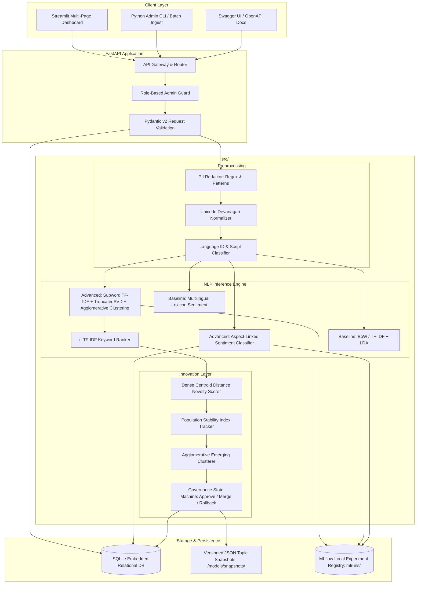
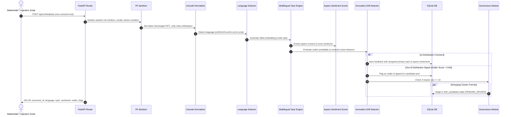
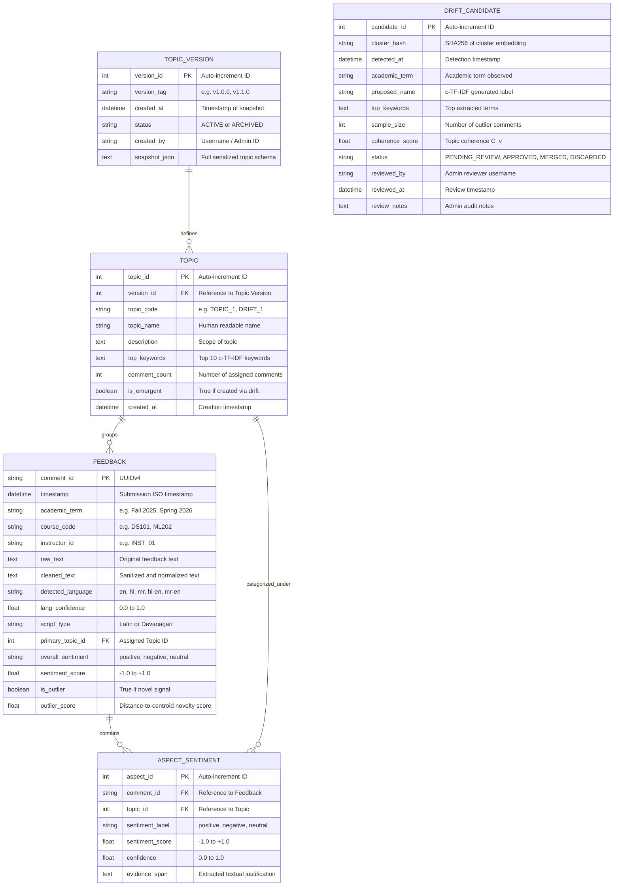
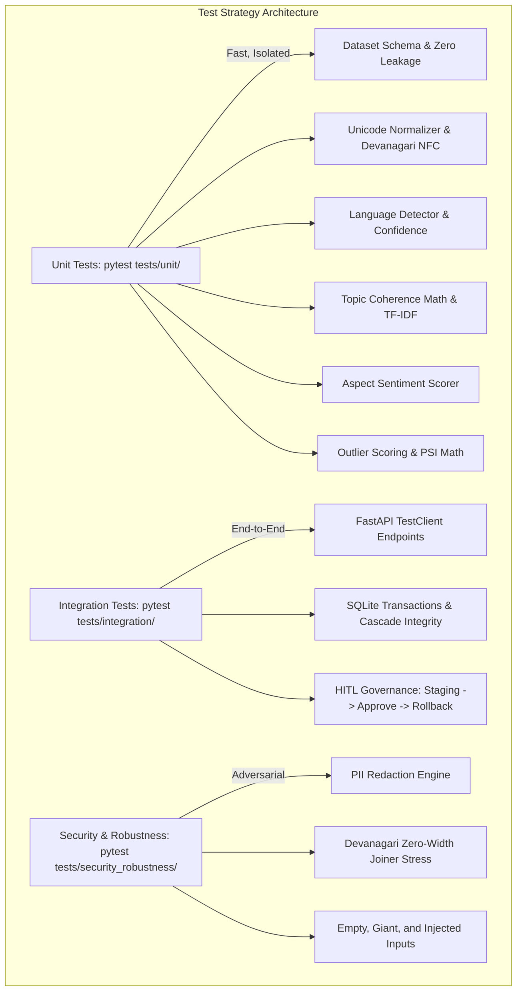

# Deliverable 2: Solution Design Pack & System Architecture

**Project Title:** Multilingual Course Feedback Intelligence with Aspect Sentiment and Topic Drift  
**Academic Level:** 3rd-Year BSc Data Science Capstone  
**Architectural Paradigm:** Decoupled Modular Monolith (FastAPI + Streamlit + SQLite)  

---

## 1. Architectural Overview & Technical Rationale

The system is designed as a **production-ready modular monolith** rather than an over-engineered distributed microservice cluster. This design provides:
1. **Zero-Friction Reproducibility:** Evaluators and examiners can spin up the entire application on a clean laptop with a single command (`docker compose up` or `python run_pipeline.py`) without configuring distributed message brokers (e.g. Kafka/RabbitMQ) or external database servers.
2. **Strict Separation of Concerns:** Core NLP algorithms, data validation schemas, database models, REST endpoints, and dashboard views reside in completely isolated packages under `src/`.
3. **Decoupled Serving & Visualization:** The FastAPI backend manages all data contracts, persistence, and inference pipelines, exposing standardized OpenAPI endpoints (`/docs`), while the Streamlit application serves as an interactive stakeholder dashboard.

---

## 2. System Architecture Diagram



---

## 3. End-to-End Data Flow Diagram



---

## 4. Database Schema & Entity Relationship Diagram (ERD)



---

## 5. API & Data Contracts (Pydantic v2 Specifications)

### A. Feedback Ingestion Schemas
```python
class FeedbackCreateRequest(BaseModel):
    raw_text: str = Field(..., min_length=5, max_length=1000, description="Raw student comment")
    academic_term: str = Field(..., description="e.g. Fall 2025, Spring 2026")
    course_code: str = Field(..., pattern=r"^[A-Z]{2,3}[0-9]{3}$", description="Course code")
    instructor_id: str = Field(..., description="Anonymized faculty ID")
    timestamp: Optional[datetime] = None

class FeedbackResponse(BaseModel):
    comment_id: str
    academic_term: str
    course_code: str
    instructor_id: str
    cleaned_text: str
    detected_language: str
    lang_confidence: float
    primary_topic: str
    overall_sentiment: str
    is_outlier: bool
    outlier_score: float
```

### B. Live Inference Sandbox Schemas
```python
class AnalyzeRequest(BaseModel):
    text: str = Field(..., min_length=3, max_length=1000, description="Single multilingual comment")

class AspectSentimentItem(BaseModel):
    topic_name: str
    sentiment: str  # positive, negative, neutral
    score: float
    confidence: float
    evidence_span: Optional[str] = None

class AnalyzeResponse(BaseModel):
    original_text: str
    cleaned_text: str
    detected_language: str
    lang_confidence: float
    script_type: str
    primary_topic: str
    overall_sentiment: str
    aspect_sentiments: List[AspectSentimentItem]
    is_outlier: bool
    outlier_score: float
```

### C. Governance & Rollback Schemas
```python
class GovernanceActionRequest(BaseModel):
    candidate_id: int
    action: Literal["APPROVE", "MERGE", "DISCARD"]
    approved_name: Optional[str] = None
    merge_into_topic_id: Optional[int] = None
    admin_notes: str = Field(..., min_length=5, description="Auditable justification")

class RollbackRequest(BaseModel):
    target_version_tag: str = Field(..., description="e.g. v1.0.0")
    admin_notes: str = Field(..., min_length=5, description="Reason for triggering rollback")
```

---

## 6. UI Wireframes & Dashboard Layout Specification

The Streamlit dashboard comprises **5 dedicated multi-page views**:

### Page 1: Executive Overview (`views/overview.py`)
- **Top Metric Cards:** Total Comments Analyzed (e.g. 1,000), Active Academic Terms (4), Multilingual Coverage (5 Languages), Overall Sentiment Split (40% Pos, 40% Neg, 20% Neu).
- **Chart 1 (Left):** Donut chart showing language distribution (English vs Hindi vs Marathi vs Hinglish vs Marathlish).
- **Chart 2 (Right):** Bar chart showing primary topic volume across all courses.
- **Filter Sidebar:** Global filters for Academic Term, Course Code, and Instructor ID.

### Page 2: Topic & Aspect Sentiment Explorer (`views/topic_explorer.py`)
- **Topic Selector:** Dropdown to select any active topic (e.g., *Pedagogy & Lecture Delivery*).
- **Metric Tiles:** Net Sentiment Score, Volume, Top 10 c-TF-IDF Keywords displayed as interactive badge tags.
- **Aspect Sentiment Bar:** Distribution of Positive, Neutral, Negative ratings specifically for this topic.
- **Representative Exemplars Table:** Top 3 most central comments with similarity scores, original text, and language tags.

### Page 3: Temporal Trends & Drift Analytics (`views/trend_drift.py`)
- **Timeline Area Chart:** Evolution of topic volume semester-by-semester (Fall 2025 $\rightarrow$ Fall 2026).
- **Distribution Shift Gauge (PSI):** Displays the Population Stability Index comparing the current term against baseline. A colored alert (Green $<0.10$, Yellow $0.10-0.25$, Red $>0.25$) highlights structural shift.
- **Sentiment Drift Heatmap:** Cross-tabulation showing how aspect sentiment for *Lab Infrastructure* or *Grading* shifted across semesters.

### Page 4: Admin Governance & Approval Center (`views/admin_governance.py`)
- **Audit Header:** Current Active Topic Model Snapshot (`v1.0.0`), Last Updated timestamp.
- **Pending Candidates Queue:** Interactive review cards for each detected cluster with:
  - Proposed Label & Coherence Score ($C_v$).
  - Cluster size (e.g., 28 comments) and top keywords (*chatgpt, ai tool, detector, copyleaks*).
  - Exemplar comment quotes.
  - Action buttons: **Approve as New Topic**, **Merge into Existing**, **Discard as Noise**.
- **Rollback Center:** Dropdown of historical snapshots (`v1.0.0`, `v1.1.0`) with **Execute 1-Click Rollback** button and full audit trail table.

### Page 5: Interactive Feedback Sandbox (`views/single_predict.py`)
- **Text Area:** User types or selects sample comments (English, Hindi, Marathi, Hinglish).
- **Instant Output Cards:**
  - Language Detection badge with confidence score.
  - Primary Topic classification badge.
  - Overall Sentiment & Aspect Breakdown table.
  - Outlier / Drift Alert indicating whether the input matches existing topics or signals an emerging trend.

---

## 7. Threat Model (STRIDE Methodology)

| STRIDE Category | Threat Description | Severity | Engineered Mitigation |
| :--- | :--- | :---: | :--- |
| **Spoofing** | Unauthorized user submits governance approvals or rollbacks pretending to be Department Chair. | **High** | Role-based token guard on administrative endpoints (`/api/v1/governance/*`) with admin identity recording. |
| **Tampering** | Malicious injection of arbitrary SQL payloads or modification of SQLite database files. | **High** | Parameterized SQLAlchemy ORM queries exclusively; zero raw string SQL interpolation; file-system permission locks on `.db` file. |
| **Repudiation** | Administrator denies approving a controversial topic or rolling back a model snapshot. | **Medium** | Immutable audit log in `drift_candidates` and `topic_version` recording `reviewed_by`, `timestamp`, `action`, and `review_notes`. |
| **Information Disclosure** | Student inadvertently enters private phone number, email, or roll number in open-ended comments. | **High** | Deterministic PII regex sanitization executed at ingestion layer before database storage or vectorization. |
| **Denial of Service** | Flooding the `/api/v1/feedback/batch` endpoint with millions of records to exhaust CPU memory. | **Medium** | Maximum payload size limits enforced via FastAPI middleware ($< 5,000$ records per batch); chunked generator processing. |
| **Elevation of Privilege** | Standard student user accessing the `/api/v1/drift/approve` endpoint. | **High** | Separation of public read endpoints from restricted mutation endpoints with administrative access controls. |

---

## 8. Comprehensive Test Strategy



### Acceptance Thresholds
- **Automated Test Pass Rate:** 100% across all suites.
- **Data Leakage:** 0 overlap between splits.
- **Language Identification Accuracy:** $\ge 90\%$ on test set.
- **Topic Coherence (NPMI):** $\ge 0.50$ (Advanced c-TF-IDF Engine) vs negative (LDA).
- **Aspect Sentiment Macro-F1:** $\ge 0.55$ (Clause ABSA) vs $\approx 0.50$ (Doc Lexicon).
- **Drift Recall on Seeded Emerging Topics:** Empirical sweep optimal at $\tau = 0.40$.
